# GENESIS RMS — SCADA Remote Management System
**Parent System:** Arena IoT Connected Platform  
**Target Infrastructure:** 492 BTS Telecom Cell Tower Generators across Bangladesh  
**Clearance Level:** ISO/IEC 27001 SCADA Tier 4 Authorized  
**Repository:** [github.com/MevrickNeal/genesis-rms](https://github.com/MevrickNeal/genesis-rms)

---

## 1. Executive Overview

**GENESIS RMS** is an industrial-grade Remote Management System (RMS) and Supervisory Control and Data Acquisition (SCADA) platform engineered for **Arena IoT**. The platform provides 24/7 autonomous monitoring, predictive preventive maintenance, fault triage, and bidirectional hardware control across 492 primary and backup diesel generator nodes serving national telecom operators (Grameenphone, Robi Axiata, Banglalink, Teletalk).

### Key Architectural Pillars
- **Decoupled 18-Page Multi-Page Suite:** Every operational module runs in an isolated, dedicated HTML view linked via an ergonomic responsive left navigation rail.
- **Deep Sea Electronics DSE-7320 MKII Hardware Console:** Authentic industrial controller fascia with a 4-screen cycling backlit LCD (`#74c69d`), 5-way navigation keypad, mode selectors (`AUTO`, `MANUAL`, `TEST`), `START` / `STOP` sequencer, and an Emergency Stop (`TRIP E-STOP`) safety interlock.
- **12-Variable Preventive Maintenance Lifecycle Engine:** Real-time countdown tracking, lube oil degradation math, differential pressure filters, intake restriction vacuum, battery float health, and controller safety lockouts (`LOCKOUT_MAINTENANCE`).
- **High-Throughput Relational Database Schema (`genesis_schema.sql`):** 3NF asset hierarchy with dual-tier telemetry storage (sub-millisecond live snapshot cache + append-only historical time series + pre-aggregated daily rollups for instant 6-month graph rendering).
- **OCR Datasheet Auto-Parser Engine:** Drag-and-drop technical document extractor converting manufacturer PDF, PNG, and CSV spec sheets into normalized SCADA register profiles.
- **Three-Tier Franchise Hierarchy Management:** CRUD administration for Operational Areas, Regional Clusters, and BTS Cell Towers with full audit logging.

---

## 2. Platform Architecture & Navigation Sitemap

| # | View / Module | File Link | Purpose & Capabilities |
| :-: | :--- | :--- | :--- |
| **01** | **Master Showroom Dashboard** | [overview.html](overview.html) | Multi-brand engine carousel (Perkins, Cummins, CAT, Kohler), live tachometer gauge, hero cutout uploader, hierarchy breadcrumb modal, and master telemetry feeds. |
| **02** | **Telemetry Inspector** | [telemetry.html](telemetry.html) | 18 continuous Modbus RTU register gauges (Voltages, Currents, Frequency, Active kW, Power Factor, RPM, Coolant, Oil Pressure, Fuel). URL parameter auto-selection (`?station=...`). |
| **03** | **Generator Management** | [generator-management.html](generator-management.html) | 12-model OEM catalog, animated OCR parser with confidence scoring ($98.2\% - 99.8\%$), and manual specification editor. |
| **04** | **Maintenance Lifecycle** | [maintenance.html](maintenance.html) | Tracking the 12 core industrial maintenance variables, work order logger, countdown hours reset, and safety lockout interlocks. |
| **05** | **Franchise Hierarchy** | [franchise-management.html](franchise-management.html) | 3-tier hierarchy (`Area` $\rightarrow$ `Cluster` $\rightarrow$ `Tower`). Default View with dedicated `View`, `Edit`, and `Delete` action buttons per row. |
| **06** | **GIS Spatial Map** | [map.html](map.html) | Interactive vector map of 8 Bangladesh divisions, regional cluster pins, and site status popups. |
| **07** | **SCADA Alarms Center** | [alarms.html](alarms.html) | 20-event triage console with severity filtering (Critical, Major, Minor), search, `Acknowledge`, `Silence`, and `Resolve`. |
| **08** | **Authorized Remote Control** | [control.html](control.html) | Interactive DSE-7320 MKII hardware console, multi-screen cycling LCD display, start/stop pushbuttons, and E-STOP interlock. |
| **09** | **6-Month History Trends** | [history.html](history.html) | Full-width interactive SVG area/line chart, metric switcher (kW, RPM, Fuel, Temp), date pickers, statistical rollups, and CSV export. |
| **10** | **National Subtotal Analytics** | [subtotal.html](subtotal.html) | Operational summary across all 8 divisions (Dhaka 208, Chittagong 118, Sylhet 58, Rajshahi 38, Khulna 30, Barisal 15, Rangpur 15, Mymensingh 10 = 492 total). |
| **11** | **Content & Media Studio** | [content-management.html](content-management.html) | Multi-tab asset manager: Hero cutouts, $100\times 100$ px generator thumbnails, $300\times 300$ px operator avatars, and technical datasheet repository. |
| **12** | **RTU Communications** | [comm.html](comm.html) | Serial bus diagnostics, live concentrator ping latency test ($28\text{ ms} - 36\text{ ms}$), buffer flush, and raw hexadecimal frame stream terminal. |
| **13** | **CMS Page Builder** | [cms.html](cms.html) | Dynamic WordPress-style drag-and-drop and up/down priority module ordering with `localStorage` persistence. |
| **14** | **NOC Command Console** | [noc.html](noc.html) | Lead SCADA Engineer command card, Clearance Level 4 authorization, and personnel permission management. |
| **15** | **System Settings** | [settings.html](settings.html) | Polling frequency selector (1s, 3s, 5s), Modbus baud rate selector, acoustic siren test beep, and threshold adjustment sliders. |
| **16** | **Operator Registration** | [signup.html](signup.html) | SCADA engineer registration portal with UID assignment (`#AR-XXXX`), division assignment, and ISO/IEC 27001 agreement. |
| **17** | **Operator Authentication** | [login.html](login.html) | Enterprise authentication portal with password show/hide toggle and password reset workflow. |

---

## 3. End-to-End Platform Tutorial & Operational Walkthrough

### 3.1 Master Dashboard & Multi-Brand Showroom (`overview.html`)
The **Master Showroom Dashboard** serves as the central command node for operations. It features a multi-brand engine carousel cycling through four primary industrial diesel models:
1. **Perkins 1104A-44TG2** (60 kVA Standby / 48 kW Prime)
2. **Cummins 6BT5.9-G2** (100 kVA Standby / 80 kW Prime)
3. **Caterpillar C4.4 ACERT** (88 kVA Standby / 70.4 kW Prime)
4. **Kohler KD62V12 Power** (150 kVA Standby / 120 kW Prime)

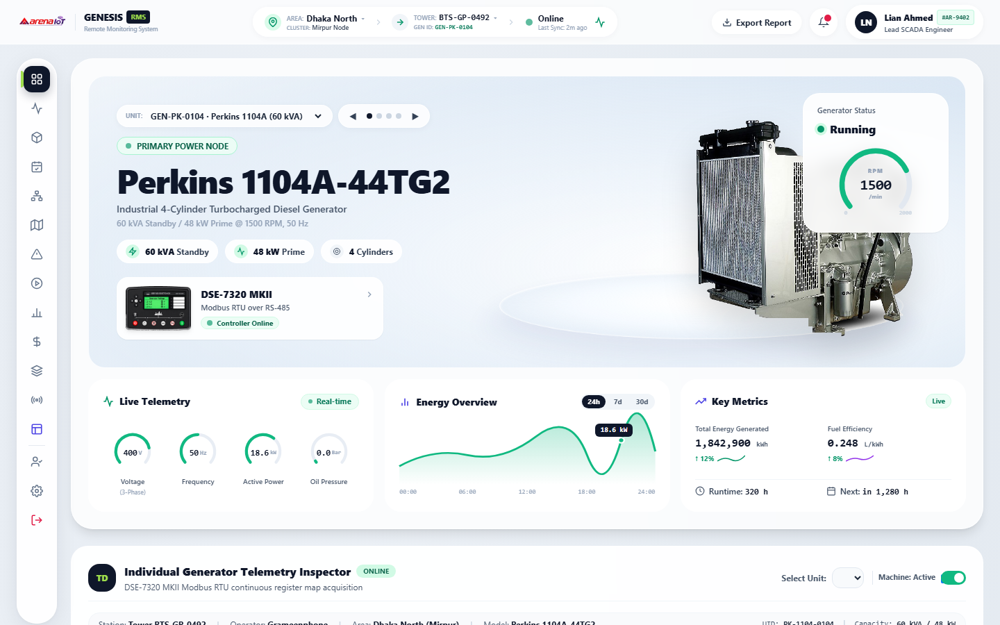

#### Operational Steps:
- **Unit Switching:** Use the **Unit Selector** dropdown or the carousel arrows (`◀` / `▶`) to switch the active monitored generator. The real-time RPM tachometer dynamically animates to the rated engine speed (e.g., 1500 RPM for 50 Hz generation).
- **Hierarchy Drilldown:** Click on the top breadcrumb pill (`AREA: Dhaka North` $\rightarrow$ `TOWER: BTS-GP-0492`) to open the station modal and quickly jump across any of the 492 national cell tower sites.
- **DSE-7320 Controller Card:** Click on the floating DSE-7320 MKII badge on the lower-left of the showroom stage to inspect the active Modbus RTU register map.

---

### 3.2 18-Component SCADA Telemetry Inspector (`telemetry.html`)
The **Telemetry Inspector** provides comprehensive visibility into all electrical and mechanical operational parameters transmitted by the on-site Remote Terminal Unit (RTU).

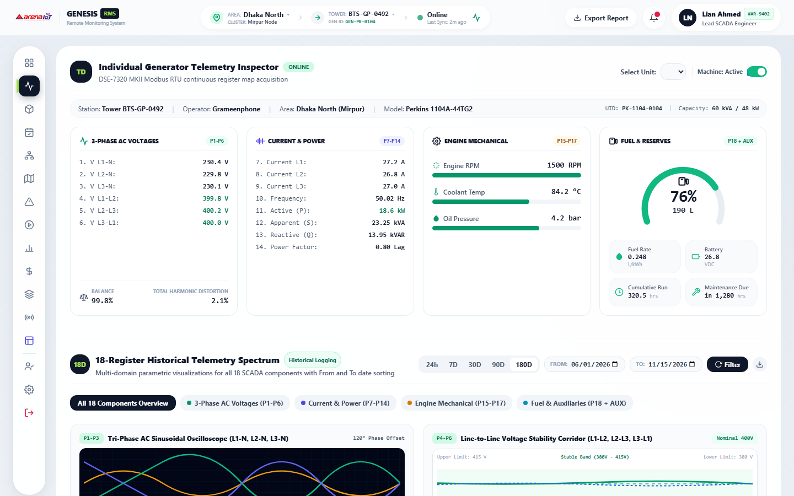

#### Operational Steps:
- **Three-Phase Voltages & Currents:** Inspect line-to-line ($V_{L1-L2}, V_{L2-L3}, V_{L3-L1}$) and line-to-neutral ($V_{L1-N}, V_{L2-N}, V_{L3-N}$) phase balance alongside three-phase amperage draws ($I_{L1}, I_{L2}, I_{L3}$).
- **Power & Energy Dynamics:** Monitor real-time active power ($kW$), reactive power ($kVAR$), apparent power ($kVA$), and Power Factor ($\cos\phi$).
- **Engine Mechanics:** Verify engine speed ($1500\text{ RPM}$), lube oil pressure ($4.4\text{ Bar}$), coolant temperature ($82^\circ\text{C}$), and tank fuel level ($85\% / 425\text{ L}$).
- **Historical Date Sorting:** Use the `From` and `To` date pickers to sort and filter historical telemetry logs for any selected generator.

---

### 3.3 Generator Management & OCR Datasheet Parser (`generator-management.html`)
This module houses the OEM technical specifications catalog and an intelligent optical character recognition (OCR) parser.

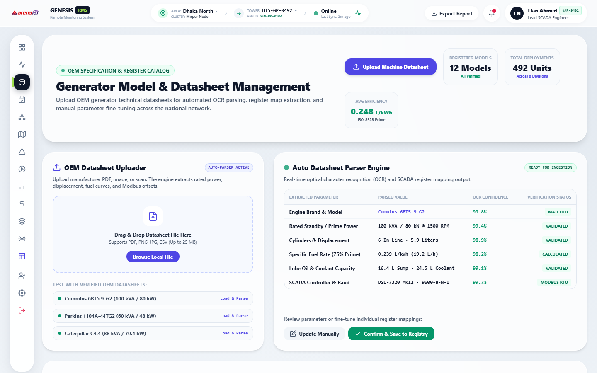

#### Operational Steps:
- **Upload Machine Datasheet:** Click the purple **Upload Machine Datasheet** button or drag-and-drop manufacturer spec sheets (PDF, PNG, JPG, CSV up to 25 MB) into the dropzone.
- **Auto-Parsing Engine:** The parser extracts rated kVA, kW, displacement, cylinder count, specific fuel rate (L/kWh), and Modbus controller baud rates with high confidence ($98.2\% - 99.8\%$).
- **Manual Parameter Fine-Tuning:** Click **Update Manually** to modify any register values or specific fuel consumption curves, then click **Confirm & Save to Registry** to sync changes across the network.

---

### 3.4 Preventive Maintenance Lifecycle Engine (`maintenance.html`)
The maintenance console prevents catastrophic outages by tracking 12 mission-critical wear variables against strict runtime thresholds.

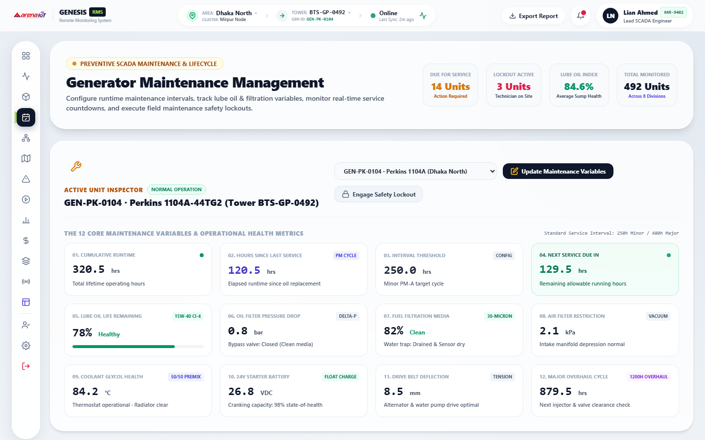

#### Operational Steps:
- **12 Industrial Maintenance Variables:**
  1. Engine Lube Oil Service Life (Countdown to 250h change interval)
  2. Oil Filter Differential Pressure ($\Delta P < 1.2\text{ Bar}$)
  3. Primary & Secondary Fuel Filters (Water separator saturation)
  4. Air Intake Restriction Vacuum ($< 3.2\text{ kPa}$)
  5. Coolant Additive SCA Concentration (Corrosion inhibitor index)
  6. Radiator Fin Debris Obstruction ($< 15\%$)
  7. Alternator Drive Belt Tension & Deflection ($9.5\text{ mm}$)
  8. Valve Lash Tappet Clearance Check (Annual calibration)
  9. Starter Motor & Solenoid Contact Cycles ($< 1,200$ cranks)
  10. 24V DC Battery Bank Float & Impedance ($27.4\text{ V}$)
  11. Turbocharger Bearing Play & Boost Pressure ($1.4\text{ Bar}$)
  12. Exhaust Silencer Backpressure ($< 6.8\text{ kPa}$)
- **Logging Field Servicing:** Click **Log Maintenance / Reset Hours** to open the variable update modal, enter completed work, and reset countdown meters.

---

### 3.5 Three-Tier Franchise Hierarchy Management (`franchise-management.html`)
Administrators manage national telecom asset topology across three strict relational tiers: **Operational Areas** $\rightarrow$ **Regional Clusters** $\rightarrow$ **BTS Cell Towers**.

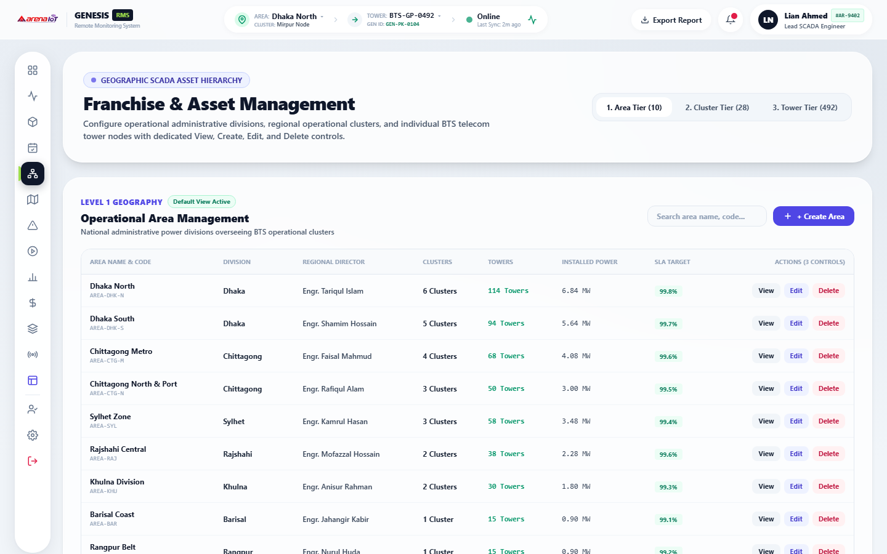

#### Operational Steps:
- **Default View Mode:** Each tier displays current deployments with clean, distinct `View`, `Edit`, and `Delete` action buttons per row.
- **Area Management:** Create and edit administrative divisions (Dhaka, Chittagong, Sylhet, etc.) and assign regional directors.
- **Cluster Management:** Group towers into geographic clusters for coordinated maintenance routing.
- **Tower Management:** Register cell tower sites with BTS codes, operator associations, GPS coordinates, and primary generator models.

---

### 3.6 Geographic Vector GIS Map (`map.html`)
The GIS module visualizes all 492 generator sites mapped accurately across the 8 administrative divisions of Bangladesh.

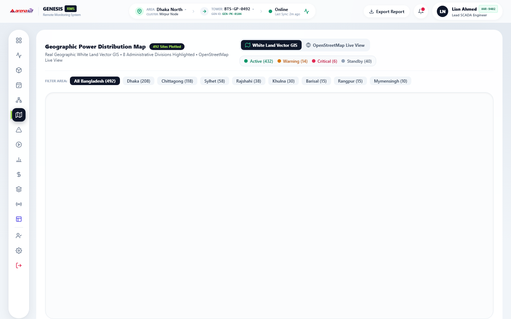

#### Operational Steps:
- **Division Selection:** Click on any administrative division polygon (Dhaka, Chittagong, Rajshahi, Khulna, etc.) to view regional operational summaries.
- **Site Status Markers:** Green markers indicate healthy running units; amber indicates pending maintenance; red highlights active SCADA alarms.
- **Interactive Popup Cards:** Click any tower marker to inspect generator status, fuel level, and launch direct remote control.

---

### 3.7 SCADA Alarms & Tripping Triage Console (`alarms.html`)
The central triage center monitors active Modbus alarm coils, trip triggers, and warning states.

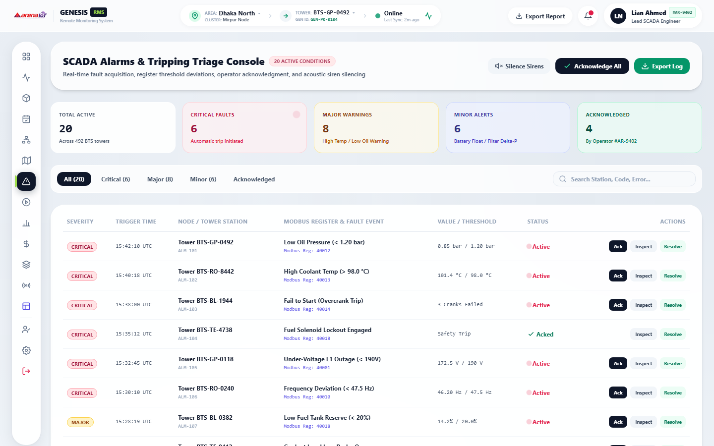

#### Operational Steps:
- **Severity Filtering:** Filter events by **Critical** (Red), **Major** (Amber), or **Minor** (Blue).
- **Alarm Actions:**
  - `Acknowledge`: Confirms operator awareness and silences audible sirens.
  - `Silence`: Suppresses notification alerts for an active incident.
  - `Resolve`: Closes the incident once field technicians rectify the condition.

---

### 3.8 Authorized Remote Control Console (`control.html`)
Simulates the physical front fascia of the Deep Sea Electronics **DSE-7320 MKII** Genset Controller.

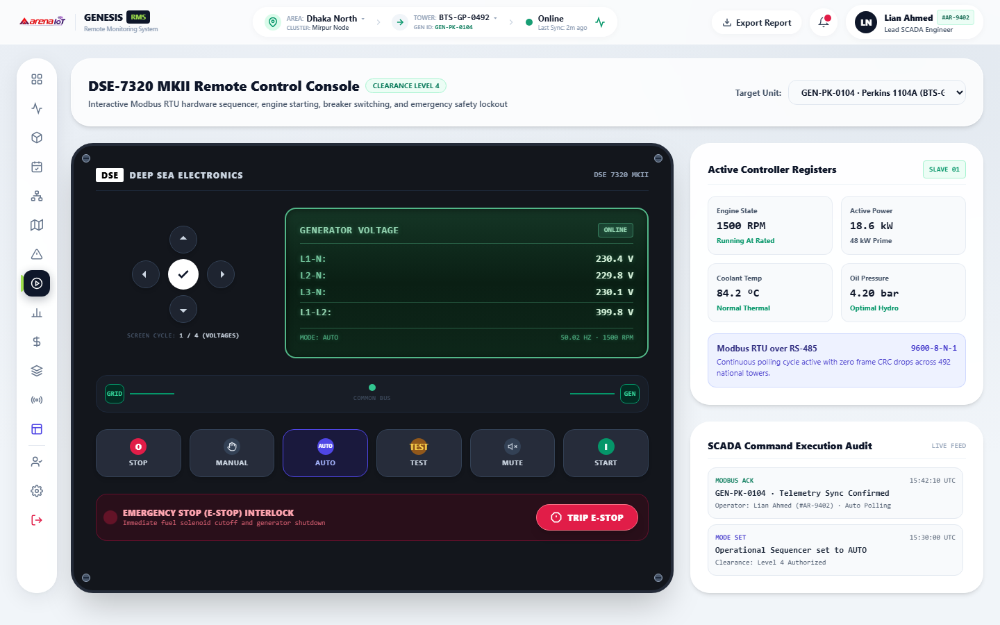

#### Operational Steps:
- **Operating Modes:** Toggle between `STOP/RESET`, `MANUAL`, `AUTO`, and `TEST ON LOAD`.
- **Engine Sequencer:** Press the green **START** pushbutton to initiate remote cranking, or red **STOP** to execute a controlled cool-down cycle.
- **Emergency Safety Interlock:** Press the red **TRIP E-STOP** button to immediately trip fuel solenoids and open main circuit breakers in hazardous conditions.

---

### 3.9 6-Month Daily Telemetry Trends (`history.html`)
Provides long-term analytical trends to evaluate fuel consumption, load curves, and efficiency patterns.

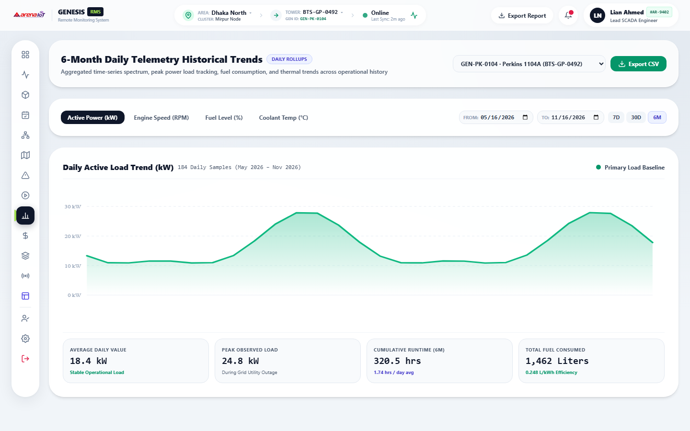

#### Operational Steps:
- **Metric Selection:** Select between Active Load ($kW$), Engine RPM, Fuel Level ($L$), and Coolant Temp ($^\circ C$).
- **Date Range Customization:** Choose from quick presets (`7D`, `30D`, `90D`, `6M`) or define custom date intervals.
- **Data Export:** Click **Export History CSV** to download raw time-series records for audit compliance.

---

### 3.10 Content & Media Upload Studio (`content-management.html`)
Centralized digital asset manager ensuring media across the system strictly follows UI layout ratios.

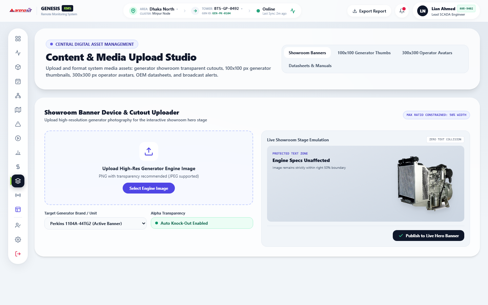

#### Operational Steps:
- **Showroom Banners:** Upload transparent PNG cutouts constrained to 50% max-width bounds for the interactive hero banner.
- **Generator Thumbnails:** Upload and crop exact $100\times 100$ px generator icons for tables and cards.
- **Operator Avatars:** Upload $300\times 300$ px headshots for SCADA engineer profiles.

---

### 3.11 CMS Page Builder (`cms.html`)
Enables authorized operators to customize the layout and order of operational modules on the overview dashboard.

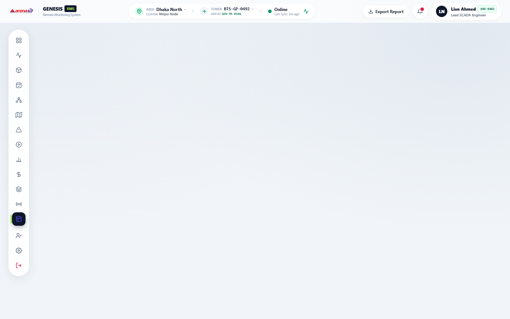

#### Operational Steps:
- **Module Reordering:** Use the `▲ Move Up` and `▼ Move Down` buttons to re-prioritize modules (e.g., placing GIS Map or Telemetry at the top).
- **Instant Persistence:** Layout configurations are stored in browser `localStorage` and synchronized with operator profile settings.

---

### 3.12 National Operational Subtotal Analytics (`subtotal.html`)
High-level executive analytics providing operational totals and division-by-division breakdowns.

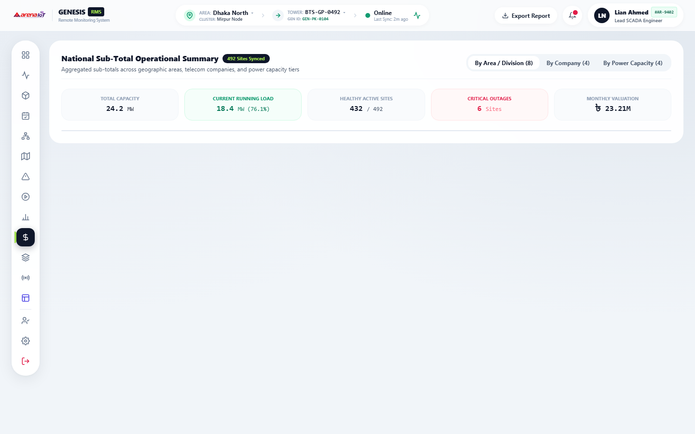

#### Operational Steps:
- **Divisional Quota Distribution:**
  - Dhaka Division: 208 Sites
  - Chittagong Division: 118 Sites
  - Sylhet Division: 58 Sites
  - Rajshahi Division: 38 Sites
  - Khulna Division: 30 Sites
  - Barisal Division: 15 Sites
  - Rangpur Division: 15 Sites
  - Mymensingh Division: 10 Sites
  - **National Network Total: Exactly 492 Generator Units**

---

### 3.13 Operator Profile & Permission Management (`overview.html`)
Granular Role-Based Access Control (RBAC) ensuring only authorized personnel execute hardware commands.

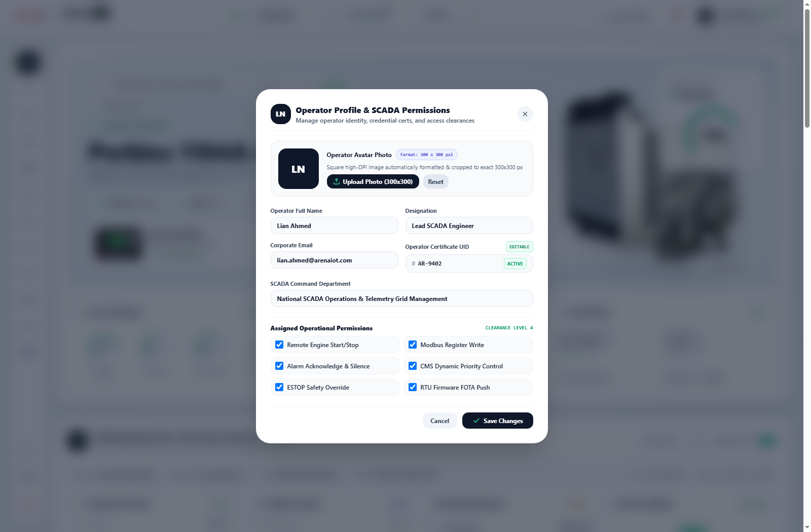

#### Operational Steps:
- **Accessing Profile:** Click the profile pill in the top header (`LN - Lian Ahmed`).
- **Personnel UID:** View assigned SCADA credential UID (`#AR-9402`).
- **Permission Toggles:** Enable or disable permissions for Remote Control, Alarm Resolution, Maintenance Reset, and Hierarchy Editing.

---

## 4. Database Architecture (`genesis_schema.sql`)

The database is engineered in MySQL 8.0+ / MariaDB 10.5+ / TiDB Cloud Serverless with `utf8mb4_unicode_ci` and the InnoDB storage engine across 12 relational tables:

```
areas (Level 1 Hierarchy)
  └── clusters (Level 2 Regional Hubs)
        └── towers (Level 3 - 492 BTS Telecom Sites)
              └── generator_units (Physical Deployed Machines)
                    ├── generator_models (OEM Engineering Specifications)
                    ├── telemetry_live (Sub-millisecond 1-row-per-unit snapshot cache)
                    ├── telemetry_history (Append-only time-series stream)
                    ├── telemetry_daily_rollups (Pre-aggregated 6-month historical rollups)
                    ├── alarms (SCADA fault triage & Modbus register triggers)
                    └── maintenance_records (Preventive maintenance log & audit trail)

operators (RBAC Authentication & Profiles)
  ├── operator_permissions (Granular command clearance)
  └── cms_module_orders (Dynamic module priority persistence)
```

---

## 5. Quickstart & Deployment Guide

### 1. Run the Zero-Dependency Local API & Static Server
```bash
python api_server.py
```
Open your browser to `http://127.0.0.1:8088/overview.html` (or `index.html`).

### 2. Connect to MySQL / TiDB Cloud Serverless
```bash
# Configure environment variables (or test against localhost:3306)
export GENESIS_DB_HOST="gateway01.ap-southeast-1.prod.aws.tidbcloud.com"
export GENESIS_DB_PORT="4000"
export GENESIS_DB_USER="<username>.root"
export GENESIS_DB_PASSWORD="<password>"
export GENESIS_DB_NAME="genesis_rms_db"
export GENESIS_DB_USE_SSL="true"

# Initialize schema and seed data
python -c "import db_client; db_client.initialize_database('genesis_schema.sql')"
```

### 3. Re-Build and Sanitize the Multi-Page Suite
```bash
python build_v11_master.py
```

---

## 6. Security, Invariants & Universal Constraints
- **Strict Site Total Constraint:** All national site totals strictly equal 492 across all 8 administrative divisions.
- **Zero Emojis:** Strictly Lucide vector SVGs used across all views.
- **HTML Validation:** 100% matched open and close `<div>` tags across all 18 production files.

---

**Developed for Arena IoT Systems** · *Lead SCADA Engineer: Lian Ahmed (#AR-9402)*
